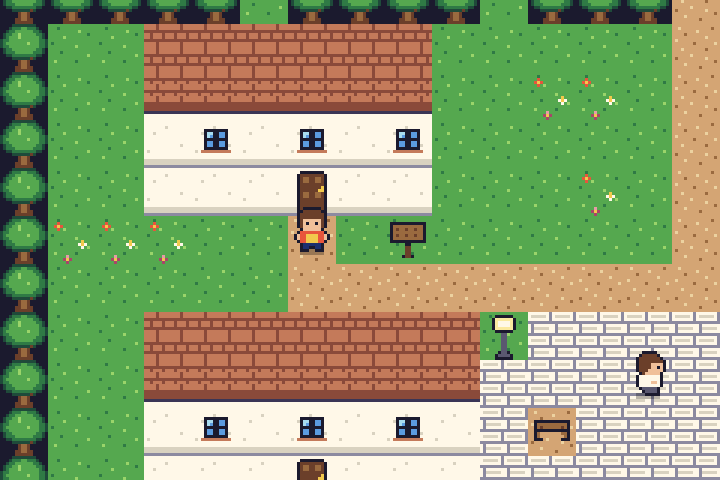
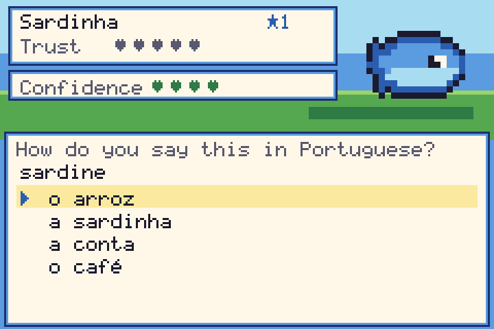

# Falabichos

**Learn European Portuguese by befriending Bichos.**

[](https://github.com/ericcurtin/falabichos/actions/workflows/ci.yml)
[](LICENSE)
[](rust-toolchain.toml)
[](https://bevy.org)
[](CONTRIBUTING.md)

*"Falabichos"* = **fala** (speak) + **bichos** (critters). You are a young learner who arrives in a small
Portuguese town and discovers that the **Bichos** live inside words. Every Bicho embodies a slice of the
language: a rooster for farm words, a tram-snail for transport, a sardine for the sea, a *Saudade* ghost for
feelings, a stork that delivers the little words *o / a / um / uma*. They are shy. To befriend one you have
to *talk* to it: translate, pick the right article, conjugate a verb, put words in order, read the
pronunciation. Get it right and its trust grows until it joins your team.

It plays like a classic top-down 16x16 monster-collecting adventure, but the "battles" are friendly
**conversations**, and the notebook you fill in is a real vocabulary and grammar notebook backed by a
**spaced-repetition scheduler**.

<p align="center">
  
  
</p>

> Everything is **authentic European Portuguese (pt-PT)**: *autocarro, telemóvel, pequeno-almoço, casa de
> banho, comboio, rapariga, fixe, bica*, `estou a comer` (not the Brazilian gerund), clitics after the verb
> (`dá-me`, `disse-lhe`), the `tu` / `o senhor` register, post-1990 spelling. See
> [docs/PT_PT_GUIDELINES.md](docs/PT_PT_GUIDELINES.md).

## Features

- **Top-down tile world** with grid-locked walking, NPCs, signs, doors and warps between maps, tall-grass
  encounter zones and trainers who challenge you when you cross their line of sight.
- **Dialogue with English gloss on demand**: press the gloss key (or the `HINT` touch button) to see the
  translation, then move a cursor over any word for a word-by-word lookup.
- **Conversation battles**: translate, choose the article, fill the blank, type the answer (on-screen
  letter grid or physical keyboard, accent- and typo-tolerant by default), order the words, read the IPA.
  Wrong answers cost *confidence*; right answers fill the Bicho's *trust*.
- **Spaced repetition** (SM-2 derivative with learning steps, in [`falabichos-core`](crates/falabichos-core)):
  failed items come back within minutes, mastered items drift apart. A Bicho's **level is driven by SRS
  mastery** of its words, and *Practice* reviews what is due.
- **Mestres and Selos**: each town has a language master with a themed test (ordering food, transport and
  polite register, ...). Beat them to earn a *Selo* (badge).
- **Bichodex = notebook**: every Bicho lists its words with IPA, pronunciation tips and your mastery; the
  **Notebook** holds 15 grammar concepts with rules, examples and a note on pt-PT vs pt-BR.
- **Pronunciation first**: IPA for every word, a tip system for nasal vowels, `ão/ões/ães`, reduced vowels,
  `lh/nh/ch`, the two r sounds, and a slot system for native-speaker recordings
  ([docs/AUDIO_GUIDE.md](docs/AUDIO_GUIDE.md)). No clip yet? The game degrades gracefully.
- **All content is data**: vocab, grammar, maps, dialogue, Bichos, towns are RON text files that teachers and
  native speakers can edit with no Rust. A linter checks everything (`falabichos-lint`).
- **Original pixel art and chiptune**, generated from compact text definitions (palette, `.px` sprites,
  `.song` files) with no third-party assets ([docs/ART_PIPELINE.md](docs/ART_PIPELINE.md)).
- **Accessible**: text size, high-contrast mode, reduce-motion, English gloss by default, keyboard, gamepad
  and touch.
- **Five platforms, one codebase**: Linux, macOS, Windows, Android, iOS. Native only (no web build).
- **Translatable UI**: the interface strings are in [`assets/i18n/en/ui.lang`](assets/i18n/en/ui.lang);
  add a folder to translate the game for speakers of other languages.

## Vertical slice (what you can play today)

3 towns (**Vila Azul**, a fishing village, **Setecolinas**, a hilly tram city, and **Ribeira Dourada**, a riverside
city), 15 maps, 13 Bichos, 124 vocabulary items, 15 grammar concepts (89 exercises), 3 Mestres with Selos,
10 trainers, a full story arc from the first conversation to the end of Part 1, plus the first town of Part 2.
See [ROADMAP.md](ROADMAP.md) for the other towns (Alentejo, Algarve, Azores, Madeira).

## Platform support

| Platform | Architecture | Status |
|----------|--------------|--------|
| Linux    | x86_64 (X11 and Wayland) | Built, tested and run by the author under a virtual display (Xvfb + software Vulkan); not yet tried on a physical GPU |
| macOS    | arm64 + x86_64 (universal `.app` / `.dmg`) | Targeted: CI + packaging written; **not yet built by the author** |
| Windows  | x86_64 (MSVC) | Targeted: CI + packaging written; **not yet built by the author** |
| Android  | arm64-v8a, armeabi-v7a, x86_64 (GameActivity, API 28+) | Targeted: Gradle + cargo-ndk written; **not yet built by the author** |
| iOS      | arm64 device, arm64 simulator | Targeted: Xcode project written; **not yet built by the author** |

The honest, per-platform verification matrix lives in [docs/PLATFORM_STATUS.md](docs/PLATFORM_STATUS.md).

## Quick start

```sh
git clone https://github.com/ericcurtin/falabichos.git
cd falabichos
cargo run -p falabichos          # debug build, optimised enough to be playable
cargo run --release -p falabichos
```

You need the Rust toolchain pinned in [`rust-toolchain.toml`](rust-toolchain.toml) (rustup installs it
for you) and, on Linux, Bevy's system libraries (below). No assets to download: everything is embedded.

**Controls**

| | Keyboard | Gamepad | Touch |
|--|----------|---------|-------|
| Move | Arrow keys / WASD | D-pad / left stick | on-screen D-pad |
| Talk, confirm | Enter / Space / Z | A (south) | `A` button or tap the screen |
| Cancel, hold to run | X / Backspace / Shift | B (east) | `B` button |
| Menu | Esc / M | Start | `MENU` |
| Gloss / hint | Tab / G | Select / Y | `HINT` |
| Fullscreen | F11 / Alt+Enter | | |

Other useful commands:

```sh
cargo run -p falabichos -- --headless-sim        # scripted full playthrough, no window needed
cargo run -p falabichos -- --screenshots out/    # replay it and write PNG screenshots
cargo run -p falabichos-tools --bin falabichos-lint          # validate all content
cargo run -p falabichos-tools --bin falabichos-mapcheck -- vila_azul   # annotated map + problems
cargo run -p falabichos-tools --bin falabichos-preview -- out/         # sprite sheets + WAVs of the music
cargo run -p falabichos-tools --bin falabichos-dashboard -- -o out/dashboard.html   # lint + coverage as one static HTML page
cargo run -p falabichos-tools --bin falabichos-report -- --format csv -o progress.csv   # teacher's progress report from save.ron (text, csv or json)
cargo xtask ci                                    # everything CI runs
```

## Building from source, per platform

Full details and signing notes: [docs/BUILDING.md](docs/BUILDING.md).

### Linux

Bevy needs ALSA, udev, a windowing stack and a Vulkan or OpenGL loader.

```sh
# Debian / Ubuntu
sudo apt install build-essential pkg-config clang mold libasound2-dev libudev-dev libwayland-dev \
  libxkbcommon-dev libx11-dev libxcursor-dev libxi-dev libxrandr-dev libgl1-mesa-dev libvulkan-dev \
  mesa-vulkan-drivers

# Fedora
sudo dnf install gcc clang mold pkgconf-pkg-config alsa-lib-devel systemd-devel wayland-devel \
  libxkbcommon-devel libX11-devel libXcursor-devel libXi-devel libXrandr-devel mesa-libGL-devel \
  mesa-libEGL-devel vulkan-loader-devel mesa-vulkan-drivers

# Arch
sudo pacman -S base-devel clang mold alsa-lib systemd-libs wayland libxkbcommon libx11 libxcursor \
  libxi libxrandr mesa vulkan-icd-loader vulkan-radeon   # or your GPU's vulkan driver
```

On an immutable distribution (Silverblue, Bazzite, ...) build inside a toolbox:
`toolbox create falabichos-dev`, install the Fedora list above inside it, then
`toolbox run -c falabichos-dev cargo run -p falabichos` (your home directory, and therefore `~/.cargo`, is shared).

### macOS

Install Xcode command line tools and rustup. `cargo run -p falabichos` works directly.
`cargo xtask package-macos` builds a universal `Falabichos.app` and `.dmg` (unsigned).

### Windows

Install rustup with the MSVC toolchain (Visual Studio Build Tools, "Desktop development with C++").
`cargo run -p falabichos`; `cargo xtask package-windows` makes a zip.

### Android

JDK 17, Android SDK + NDK 26, `cargo install cargo-ndk`, Gradle 8.7+, and the Rust targets
`aarch64-linux-android armv7-linux-androideabi x86_64-linux-android`. Then `cargo xtask android`
(add `--aab` for a Play Store bundle). Install with `adb install mobile/android/app/build/outputs/apk/release/*.apk`.

### iOS

macOS with Xcode 15+, `rustup target add aarch64-apple-ios aarch64-apple-ios-sim`.
`cargo xtask ios` builds for the simulator (`--device` for hardware, which needs your signing identity).

## Project layout

| Path | What it is |
|------|------------|
| `crates/falabichos-core` | Pure game logic: content model, SRS, exercises, answer matching, battles, saves. No engine. |
| `crates/falabichos-assets` | Embeds `assets/` into the binary; also reads a directory for modding. |
| `crates/falabichos-content` | Loads and validates the RON content files. |
| `crates/falabichos-media` | Pixel-art parser, bitmap font (pt-PT diacritics + IPA), software canvas, chiptune synth. |
| `crates/falabichos-game` | The game itself (scenes, world, dialogue, battle UI, menus), engine-agnostic, plus the headless simulator. |
| `crates/falabichos` | The Bevy client: window, input, audio, mobile entry points. |
| `crates/falabichos-tools` | `falabichos-lint`, `-mapcheck`, `-preview`, `-new` (scaffolder). |
| `xtask` | `cargo xtask ci / desktop / package-* / android / ios`. |
| `assets/` | **All content and art as data**: `content/`, `art/`, `music/`, `audio/`, `i18n/`. |
| `mobile/` | Android (Gradle + GameActivity) and iOS (Xcode) projects. |
| `docs/` | Architecture, content format, how-tos, guidelines, status. |

## Contributing

You do **not** need to know Rust. We need native speakers, pixel artists, musicians and voice actors,
teachers, and Rust developers: [CONTRIBUTING.md](CONTRIBUTING.md). Start with
[docs/GOOD_FIRST_ISSUES.md](docs/GOOD_FIRST_ISSUES.md) (25+ small tasks).

**Nothing in this repository has been reviewed by a native speaker yet.** Every vocabulary item, IPA
transcription and several dialogue lines carry `needs_native_review: true`. Clearing those flags is the
single most valuable contribution you can make.

## Roadmap

Towns 4 to 8 (Alentejo, Algarve, Azores, Madeira, the final Grande Mestre), native-speaker audio,
more grammar (pretérito perfeito, por/para, subjunctive), community UI translations. See [ROADMAP.md](ROADMAP.md).

## Licence

**Everything**, code *and* content, text, art and audio data, is licensed under the
[Apache License 2.0](LICENSE) and nothing else. See [NOTICE](NOTICE) and [THIRD_PARTY.md](THIRD_PARTY.md).
Contributions are accepted under the same licence (section 5 of the licence; see CONTRIBUTING.md).

Falabichos is an independent project. It is not affiliated with, endorsed by, or derived from any
commercial game franchise, and contains none of their assets or names.
